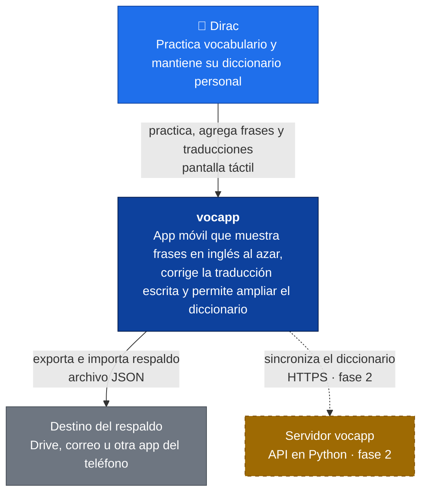
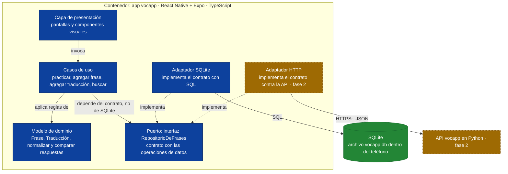
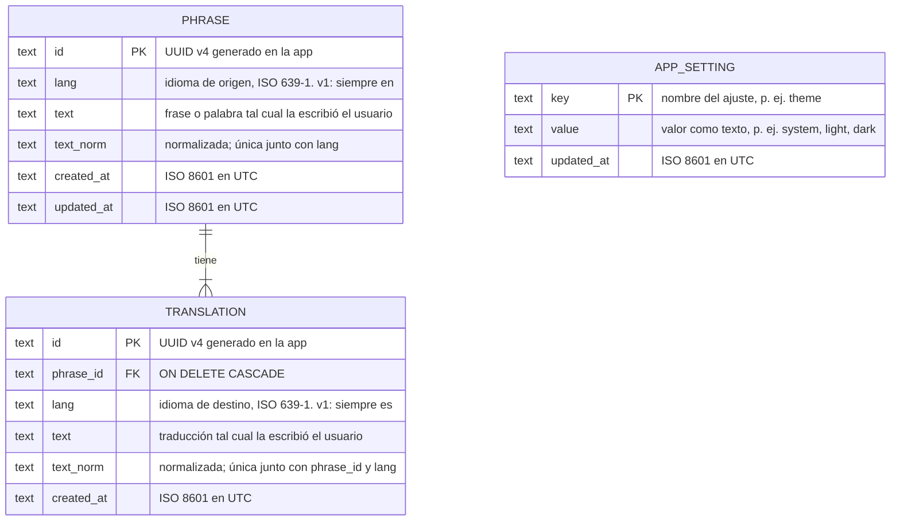
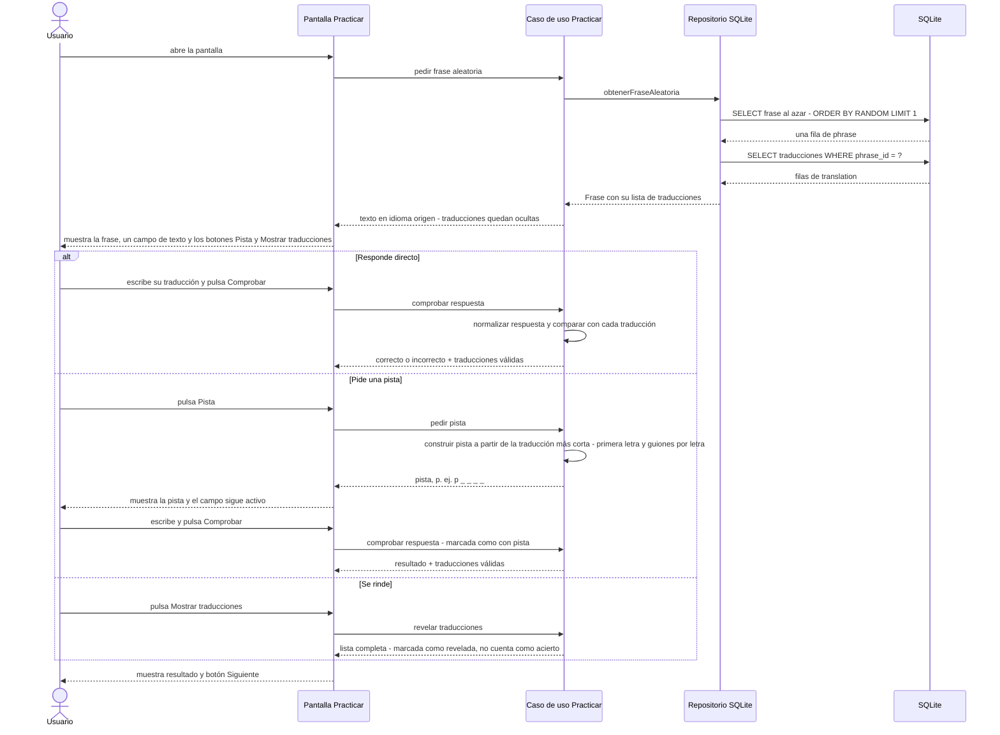

# Diagramas de arquitectura · vocapp

Un solo archivo, un diagrama por sección, cada uno en un bloque `mermaid`. Es la única fuente de verdad de los diagramas: los demás documentos enlazan aquí por ancla y nunca copian un bloque.

Se ven renderizados en la vista previa de Markdown de VS Code (extensión *Markdown Preview Mermaid Support*) y en GitHub. Para comprobar que todos compilan antes de entregar:

```bash
.claude/skills/system-diagrams/scripts/validate_mermaid.sh docs/architecture/diagrams.md
```

---

## C1 Contexto

**Pregunta que responde:** ¿qué es vocapp y con quién habla?

Color: azul = persona · azul oscuro = el sistema · gris = externo · ámbar punteado = planificado (fase 2, no existe hoy).



---

## C3 Componentes de la app

**Pregunta que responde:** ¿qué hay dentro de la app y en qué dirección dependen las piezas?

Las flechas continuas son dependencias de código. Las punteadas "implementa" muestran que un adaptador cumple el contrato del puerto. Ámbar punteado = fase 2, no se construye hoy. Este diagrama hace visible el principio D de SOLID: los casos de uso y el adaptador dependen ambos de la interfaz, nunca el caso de uso de SQLite.



---

## ER Modelo de datos

**Pregunta que responde:** ¿cómo se estructuran los datos en la versión 1?

SQLite no tiene tipo UUID ni fecha: ambos se guardan como TEXT. Los idiomas van como código ISO 639-1 de dos letras (`en`, `es`, `pt`) para que un futuro par portugués → español no exija cambiar tablas (ADR-0006). La regla "toda frase tiene al menos una traducción" la garantiza la app en una transacción; SQLite no puede declararla. `app_setting` no se relaciona con nada: guarda preferencias del dispositivo.



---

## Secuencia Practicar

**Pregunta que responde:** ¿en qué orden hablan las capas durante el flujo crítico "practicar"?

El bloque `alt` muestra caminos alternativos: el usuario responde directo, pide una pista, o se rinde y ve las traducciones (RF-14). Cada camino termina en Siguiente. El resultado tiene cuatro valores posibles (acierto, fallo, con pista, revelado), preparados para la tabla de intentos de la versión 2.


